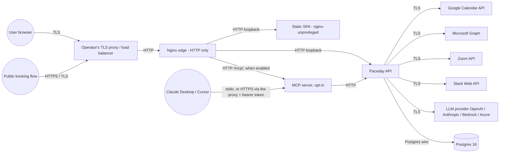

# Security — Paceday

Threat model and security posture for the Paceday system. Updated when any of: a new external boundary is introduced, a new auth/authz path is added, a new data class is stored, or a new privileged operation is exposed. Reviewed quarterly.

Owner: security-engineer skill (see workspace `AGENT_TEAM.md`).

## 1. Assets

| Asset | Sensitivity | Notes |
|---|---|---|
| **OAuth tokens** (Google, Microsoft, Zoom) | **Critical** | Long-lived refresh tokens; per-user since migration 017. Used to read/write the user's calendar on their behalf. |
| **JWT session cookie** | **Critical** | HS256-signed (`backend/auth/jwt.go`); `Secure` (unless `PACEDAY_INSECURE_COOKIES=true`, plain-HTTP dev/e2e only — PAC-20) / `HttpOnly: true`. Compromise = full account takeover until expiry. |
| **Calendar event data** | **High** | Meeting titles, attendees, locations, descriptions. May include confidential meeting agendas. |
| **User profile** (email, name, org) | **Medium** | Email is the join key for SSO and bookings. |
| **Stored credentials** (OAuth tokens, Outlook/Zoom records, AI API keys of users and organisations, Slack/Notion tokens, webcal and personal-calendar URLs, SSO client secrets and SAML certificates) | **High** | Encrypted at rest since PAC-84: AES-256-GCM under data keys wrapped by `PACEDAY_ENCRYPTION_KEY`, which lives in `encryption.env` outside the database and the backup set; each value is bound to its table, column and row. A database or dump alone opens none of them. Values not yet converted (before the first conversion pass) and dumps taken before PAC-84 still hold them in plain text. SMTP credentials are environment variables (`.env`), not rows. |
| **Scheduling links + bookings** | **Medium** | Publicly bookable via slug; booker email becomes part of the calendar event. |
| **Manager / team metadata** | **Medium** | Org structure, 1:1 cadence, missed-meeting analytics. |
| **Audit log** (`audit_log` table) | **Low** | Append-only record of focus_created and similar events. |

## 2. Trust boundaries

Trust boundaries (numbered for STRIDE table below):

1. **B1 — Browser → Edge**: TLS is terminated by the operator's proxy or load balancer in front of nginx, which also sets HSTS (owner decision 2026-10-27). nginx speaks plain HTTP only and never redirects to HTTPS. It believes `X-Forwarded-For` / `X-Forwarded-Proto` only from the addresses in `NGINX_TRUSTED_PROXIES` (empty by default: nothing trusted) and sets the browser security headers (PAC-81 Part B).
2. **B2 — Edge → Backend / Frontend**: Loopback HTTP inside docker-compose network.
3. **B3 — Backend → Postgres**: SQL on the compose network. No TLS at rest in dev; production should enable.
4. **B4 — Backend → 3rd-party APIs**: Google, MS, Zoom, Slack, LLM — TLS, OAuth or API-key auth.
5. **B5 — MCP server → Backend**: HTTP inside the compose network. The MCP server sends no user credential to the backend (out of scope for PAC-81; see §6 risks).
6. **B6 — MCP client → MCP**: either stdio (runs as the user — implicit trust) or, when the operator enables MCP in production (`docker-compose.mcp.yml`), SSE over the public origin: through the operator's TLS proxy and nginx at `/mcp/`, every request carrying `Authorization: Bearer <MCP_AUTH_TOKEN>` (owner decision PAC-81 Q-O1, 2026-11-01). The MCP container publishes no port.
7. **B7 — Anonymous booker → Public booking**: unauthenticated. Mitigated only by per-client rate limits (NEW-booking-rate-limit): 20 booking requests per client per fixed 10-minute window and 120 slot listings per client per fixed 1-minute window, keyed on the socket peer (or `X-Real-IP` from a `TRUSTED_PROXIES` peer only), per backend process (N per replica; a restart clears the counts). There is no per-slug or per-host limit and no booker-email confirmation: a booking is confirmed immediately and the booker email is invited to each host's event. The booking time is not validated against availability (API-094, open).
8. **B8 — Anyone → readiness probe** (`GET /api/ready`, PAC-81 Part A): unauthenticated and outside every rate limit, because health checkers must reach it. Concurrent calls share one database ping (at most one in flight per process), so a flood cannot hold more than one pooled connection. Its answer and latency still reveal database health and deploy timing (the 503 window after SIGTERM). Operators may restrict `/api/ready` to their health checker's address at their proxy; liveness (`/api/health`) stays open because the web app uses it.

## 3. STRIDE per boundary

| Boundary | Spoofing | Tampering | Repudiation | Information disclosure | Denial of service | Elevation of privilege |
|---|---|---|---|---|---|---|
| **B1 (Browser→Edge)** | Phishing of paceday.* domain (out of scope; rely on registrar + HSTS). **TLS and HSTS are the proxy's responsibility**, not Paceday's: recommended `Strict-Transport-Security: max-age=31536000; includeSubDomains` (no `preload` unless the operator chooses it). nginx never sends HSTS. Forwarded client address and scheme are believed only from `NGINX_TRUSTED_PROXIES`. | TLS at the proxy. nginx sets `Content-Security-Policy` (no inline script, no eval, images only from the site, `data:` and `*.googleusercontent.com`), `X-Content-Type-Options: nosniff` and `Referrer-Policy: strict-origin-when-cross-origin` on every response (PAC-81 Part B). Framing: `frame-ancestors 'none'` and `X-Frame-Options: DENY` on every response except the public booking page `/book/{slug}`, which any site may frame (`frame-ancestors *`, no `X-Frame-Options`; owner decision PAC-81 Q-O2, 2026-11-01). That page is unauthenticated and acts only on the booker's explicit input, so clickjacking it gains nothing an attacker could not do by visiting it. Every other page refuses to be framed. Framability is decided on the **raw path** as well as the normalised one (PAC-91): nginx frames a response only when both `$uri` and the request target as received (`$request_uri` up to its first `?`, escapes compared case-insensitively, query ignored) are `/book/`, one plain segment (no `/`, no `%2F`/`%5C`, not a dot segment in any spelling) and an optional `/`, so a crafted address such as `/settings/..%2Fbook/x`, which nginx normalises to the booking page while the browser and the app see another page, is refused (`nginx/test/pac91_test.go`); `/book//x` and literal dot segments are refused too, though the file server already redirects them to the genuine booking page. **Deployment requirement:** the TLS proxy in front must forward the request target unchanged — no percent-decoding, no slash merging, no dot-segment resolution — or nginx decides on a path the browser never shows (a proxy merging `//` would make `/book//x` framable while the app shows its not-found page; the web guard below then shows only its notice). Because the booking page is the single-page app, the header alone cannot stop a client-side navigation inside a frame, so two web mitigations close that path (PAC-91, Enach/smart-calendar-flow): every link on the booking page that leads elsewhere in Paceday targets the top level (`target="_top"`, never the frame), and the app refuses to render any route other than the booking page when it is framed (a notice with one top-level link; no API request, no redirect). Defence in depth: the session cookie is `SameSite=Lax`, so a cross-site frame carries no session. | nginx access log: real client address, method, path without query string, status. | TLS prevents passive sniff. | No nginx-level rate limit by design: abuse protection is application-level (B7). nginx caps bodies at 1 MiB and upstream waits at 130 s. | n/a |
| **B2 (Edge→Backend)** | Compose-network isolation. nginx's plain-HTTP port is the only published port (bind address `NGINX_BIND_ADDRESS`, `127.0.0.1` when the proxy is on the same host); no 443, no certificate, and MCP publishes nothing (PAC-81 Part C). | Loopback only. | nginx's access log records the status and the real client address (PAC-81 Part B). Backend `loggingMiddleware` logs method+path+latency (status not captured until PAC-81 Part A, AC-A13). | n/a | Per-process timeouts. | n/a |
| **B3 (Backend→DB)** | DB password in compose env; rotated via secret-store in prod (out of scope for the agent team; documented as a follow-up). | Parameterized queries throughout — verified by arch review (§5 of the report). An encrypted credential copied to another row or column fails to decrypt (PAC-84 binding). | DB-level audit log via `audit_log` table (`storage.WriteAuditLog`); `operator_audit` for operator encryption commands. | Stored credentials are encrypted by the backend before they reach Postgres (PAC-84); the key never travels to the database (no `pgcrypto`). Disk-level encryption of the rest is left to the host. | Postgres `max_connections` + pool config in `storage.Open`. | Single DB role used by the app; not least-privileged. Tracked. |
| **B4 (Backend→3rd-party)** | OAuth flow with state cookie; every state cookie is `HttpOnly`, `SameSite=Lax` and `Secure` (PAC-20). | TLS + JWT/OAuth bearer at each provider. | Calls logged but not centralized. | Tokens never logged at info+; logging redaction utility to be added (arch review item §12 — structured logging). | Per-provider rate-limit per-user; aggressive retries currently absent. | Tokens scoped per user since migration 017 + PR #35. |
| **B5/B6 (MCP)** | MCP is opt-in (`docker-compose.mcp.yml`); when enabled it is reachable from the internet through the proxy and nginx at `/mcp/` (Q-O1), and every request needs `MCP_AUTH_TOKEN`: compose refuses to start MCP with the token unset or empty, and the server refuses to start without it (PAC-81 Part C). The token is a single shared secret, not per user. | HTTP only. | Backend logs all access. | Same as B2. | Same as B2. | MCP carries full backend privileges — a compromised MCP client = full account. |
| **B6 (Claude→MCP)** | Stdio under the user's local account — trusted by definition. | n/a | n/a | n/a | n/a | n/a |
| **B7 (Anon→Booking)** | None possible (anonymous); the booker email is unverified and attacker-chosen. | Only minimum notice and overlap with the link's own bookings are checked; **no validation of booking time vs availability, link hours or a date bound** (API-094, open). | Booking creates a calendar event carrying the (unverified) booker email. | Slugs are random base32; can't be enumerated. The link-info read is unlimited, so 404 vs 200 is free to probe. | Per-client limits: 20 bookings / 10 min, 120 slot listings / min, per process (NEW-booking-rate-limit). A distributed flood (many addresses) is not stopped. | Booking can write to host's calendar at any time past minimum notice — **not** bounded by the per-link window (API-094). |

## 4. Authentication & authorization

- **JWT** (HS256) issued by `backend/auth/jwt.go` on successful OAuth. Cookie `auth_token`; `HttpOnly`, `SameSite=Lax`, `Secure` unless the operator sets `PACEDAY_INSECURE_COOKIES=true` for plain-HTTP development or e2e (PAC-20; never in production). Every cookie is set through `setCookie` in `backend/api/cookies.go`.
- **JWT_SECRET** is now a hard fail at startup (PR #7).
- **Token scoping**: every `oauth_tokens` row keyed by `(user_id, calendar_id)` since migration 017. Handlers resolve userID from ctx via `auth.UserIDFromContext`; `auth.LoadUserToken(db, uuid.Nil)` returns `ErrNoUser` — no silent legacy fallback.
- **Cron paths**: per-user iteration since PR #35. Each cron tick scopes ctx with `auth.UserIDKey` before any storage call.
- **SSO/OIDC**: per-org SSO via `backend/auth/sso_detect.go` + `oidc.go`; `oauth_state` cookie is the CSRF token.
- **CORS**: `corsMiddleware` reflects exact origin when `ALLOWED_ORIGIN` set; falls back to wildcard without `Allow-Credentials` when unset (safer default; cookies don't propagate).
- **CODEOWNERS**: `@Enach` (single-owner repo; review requirement satisfied by agent-team verdicts).

## 5. Data lifecycle

- **OAuth tokens**: rotated by `golang.org/x/oauth2` library; `UpsertUserToken` writes the new tokens on each refresh.
- **JWT**: 7-day expiry (verify in `auth/jwt.go`); rotated on `/api/auth/me` heartbeat.
- **Calendar event data**: not persisted server-side; fetched on demand from Google/MS APIs and cached for the request lifetime only.
- **Settings**: persistent; the credentials in them (AI keys, Outlook/Zoom records, webcal URL) are encrypted at rest (PAC-84, `docs/runbook.md` "Encryption key"). SMTP credentials are environment variables, not settings.
- **Audit log**: never purged; size growth tracked.
- **Dependabot**: daily for npm/pip/docker/gh-actions; patch/minor auto-merge on green CI; major bumps closed for manual triage.

## 6. Top open risks (ranked by severity × exposure)

1. **🟠 MCP server auth** (B5/B6). Since PAC-81 Part C, MCP is opt-in and, when enabled, served on the public origin behind one shared bearer token (`MCP_AUTH_TOKEN`, required: compose and the server both refuse to start without it). Remaining risk: the token is the only barrier between the internet and every MCP tool, it is shared rather than per user, nothing limits guessing attempts at nginx, and the MCP server forwards no user identity to the backend. Use a long random token (`openssl rand -hex 32`), rotate it on any suspicion, and leave MCP disabled unless needed.

2. ~~**🟠 oauth_state cookie missing `Secure: true`** (B4).~~ Fixed by PAC-20: every cookie carries `Secure` unless `PACEDAY_INSECURE_COOKIES=true` (plain-HTTP dev/e2e only).

3. ~~**🟠 nginx production config lacks TLS / HSTS / CSP / rate-limit** (B1, B7).~~ Resolved by PAC-81 Part B. TLS and HSTS are out of scope for Paceday by owner decision 2026-10-27: the proxy in front terminates TLS and sets HSTS (B1). nginx now sets CSP, `X-Frame-Options`, `nosniff` and `Referrer-Policy`. nginx-level rate limiting is deliberately not used: abuse protection is application-level (B7, NEW-booking-rate-limit).

4. ~~**🟠 LLM provider API keys + SMTP creds in plaintext `settings` columns** (asset).~~ Resolved by PAC-84: every stored credential is encrypted at rest (AES-256-GCM, envelope keys, the key-encryption key from `encryption.env`; `pgcrypto` rejected because the key would reach the database's logs). Remaining: the key is an environment variable visible to whoever controls Docker on the host (`docker inspect`) until a KMS-backed key (follow-up); SMTP credentials are environment variables, not rows.

5. ~~**🟡 No rate limit on `/api/book/{slug}` slot fetch + booking POST** (B7).~~ Partly fixed by NEW-booking-rate-limit: per-client limits of 20 bookings per 10 minutes and 120 slot listings per minute (`backend/api/ratelimit_booking.go`). Still open: limits are per process, a client is one exact address (no IPv6 prefix grouping), and distributed floods are not stopped. nginx forwards the real client address only when the operator sets `NGINX_TRUSTED_PROXIES` to the proxy's address (PAC-81 Part B); left empty, every booker behind the proxy shares one budget.

6. **🟡 Single DB role for the app — not least-privileged**. Reads + writes use the same credentials. Read-only replica role would harden analytics/recap paths.

7. **🟡 `loggingMiddleware` doesn't capture status code** (B2). Limits incident response — can't tell 200 from 500 in the access log.

8. **🟡 No `Secure` flag on the demo / mock-mode flags in `sessionStorage`** (frontend). Low impact (booleans, not secrets) but documented.

9. **🟠 Public booking time is never validated against availability** (B7, API-094). Any start past the link's minimum notice that does not overlap the link's own bookings is accepted and written to the hosts' calendars, including over busy time, outside the link's hours and arbitrarily far ahead. Open; needs its own spec and PAC issue.

10. ~~**🟠 Database backups contain users' provider credentials** (asset, PAC-81 F-D5).~~ Resolved by PAC-84 for dumps taken after the conversion: the credentials in them are encrypted, and the key is kept apart from the backup set (`backup.sh` refuses an env file holding it). Remaining: dumps taken before the conversion still hold plain credentials until the 14-day retention removes them; every dump still holds personal and calendar data and is a secret (`docs/runbook.md`, "Backups are secrets"); team invitation tokens are stored as is (hash follow-up).

## 7. Out of scope (and why)

- Physical security of the self-hosted runners and the production server (assumed trusted infra).
- Supply-chain attacks against `bun`/`go install`/`docker` registries (mitigated via lockfile pinning + Trivy scanning).
- Frontend code-injection from third-party scripts: no analytics or 3rd-party scripts are loaded.
- HSM-grade secret protection: out of scope for v1; tracked separately.

## 8. Review cadence

- **Every PR touching `backend/auth/`, `backend/api/middleware.go`, or any `*token*` storage**: security-engineer must approve.
- **Every PR adding a new external API or boundary**: re-validate the STRIDE table; update §3 if a new row is needed.
- **Quarterly walk-through** (Jan / Apr / Jul / Oct) — security-engineer revisits §6 and re-ranks.
- **Dependabot HIGH/CRITICAL CVE**: 24h SLO; tracked in `security-engineer` skill.

## 9. References

- ADR-0001 (`docs/adr/0001-tech-stack.md`): existing conventions.
- ADR-0002 (`docs/adr/0002-frontend-source-of-truth.md`): frontend in standalone repo.
- ADR-0003 (`docs/adr/0003-per-user-cron-iteration.md`): cron + storage per-user.
- Architecture review (this session): full backend + frontend + infra audit.
- `backend/auth/context.go`: where the userID context key lives.
- `backend/storage/migrations/017_*.sql`: oauth_tokens per-user-per-calendar.
- `backend/storage/migrations/018_*.sql`: settings + personal_calendars per-user backfill.
