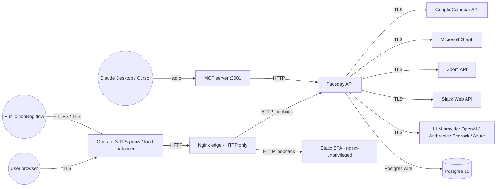

# Security — Paceday

Threat model and security posture for the Paceday system. Updated when any of: a new external boundary is introduced, a new auth/authz path is added, a new data class is stored, or a new privileged operation is exposed. Reviewed quarterly.

Owner: security-engineer skill (see workspace `AGENT_TEAM.md`).

## 1. Assets

| Asset | Sensitivity | Notes |
|---|---|---|
| **OAuth tokens** (Google, Microsoft, Zoom) | **Critical** | Long-lived refresh tokens; per-user since migration 017. Used to read/write the user's calendar on their behalf. |
| **JWT session cookie** | **Critical** | HS256-signed (`backend/auth/jwt.go`); `Secure` (unless `PACEDAY_INSECURE_COOKIES=true`, plain-HTTP dev/e2e only — PAC-20) / `HttpOnly: true`. Compromise = full account takeover until expiry. |
| **Calendar event data** | **High** | Meeting titles, attendees, locations, descriptions. May include confidential meeting agendas. |
| **User profile** (email, name, org) | **Medium** | Email is the join key for SSO and bookings. |
| **Settings** (LLM API keys, SMTP creds, Slack tokens, AWS/GCP profiles) | **High** | Stored in plaintext in the `settings` table. Anyone with DB access reads these. |
| **Scheduling links + bookings** | **Medium** | Publicly bookable via slug; booker email becomes part of the calendar event. |
| **Manager / team metadata** | **Medium** | Org structure, 1:1 cadence, missed-meeting analytics. |
| **Audit log** (`audit_log` table) | **Low** | Append-only record of focus_created and similar events. |

## 2. Trust boundaries

Trust boundaries (numbered for STRIDE table below):

1. **B1 — Browser → Edge**: TLS is terminated by the operator's proxy or load balancer in front of nginx, which also sets HSTS (owner decision 2026-10-27). nginx speaks plain HTTP only and never redirects to HTTPS. It believes `X-Forwarded-For` / `X-Forwarded-Proto` only from the addresses in `NGINX_TRUSTED_PROXIES` (empty by default: nothing trusted) and sets the browser security headers (PAC-81 Part B).
2. **B2 — Edge → Backend / Frontend**: Loopback HTTP inside docker-compose network.
3. **B3 — Backend → Postgres**: SQL on the compose network. No TLS at rest in dev; production should enable.
4. **B4 — Backend → 3rd-party APIs**: Google, MS, Zoom, Slack, LLM — TLS, OAuth or API-key auth.
5. **B5 — MCP server → Backend**: HTTP on `:3001` inside the compose network. Currently no auth — MCP-side enforcement deferred (see §6 risks).
6. **B6 — Claude → MCP**: stdio, runs as the user — implicit trust.
7. **B7 — Anonymous booker → Public booking**: unauthenticated. Mitigated only by per-client rate limits (NEW-booking-rate-limit): 20 booking requests per client per fixed 10-minute window and 120 slot listings per client per fixed 1-minute window, keyed on the socket peer (or `X-Real-IP` from a `TRUSTED_PROXIES` peer only), per backend process (N per replica; a restart clears the counts). There is no per-slug or per-host limit and no booker-email confirmation: a booking is confirmed immediately and the booker email is invited to each host's event. The booking time is not validated against availability (API-094, open).
8. **B8 — Anyone → readiness probe** (`GET /api/ready`, PAC-81 Part A): unauthenticated and outside every rate limit, because health checkers must reach it. Concurrent calls share one database ping (at most one in flight per process), so a flood cannot hold more than one pooled connection. Its answer and latency still reveal database health and deploy timing (the 503 window after SIGTERM). Operators may restrict `/api/ready` to their health checker's address at their proxy; liveness (`/api/health`) stays open because the web app uses it.

## 3. STRIDE per boundary

| Boundary | Spoofing | Tampering | Repudiation | Information disclosure | Denial of service | Elevation of privilege |
|---|---|---|---|---|---|---|
| **B1 (Browser→Edge)** | Phishing of paceday.* domain (out of scope; rely on registrar + HSTS). **TLS and HSTS are the proxy's responsibility**, not Paceday's: recommended `Strict-Transport-Security: max-age=31536000; includeSubDomains` (no `preload` unless the operator chooses it). nginx never sends HSTS. Forwarded client address and scheme are believed only from `NGINX_TRUSTED_PROXIES`. | TLS at the proxy. nginx sets `Content-Security-Policy` (no inline script, no eval, no framing, images only from the site, `data:` and `*.googleusercontent.com`), `X-Frame-Options: DENY`, `X-Content-Type-Options: nosniff` and `Referrer-Policy: strict-origin-when-cross-origin` on every response (PAC-81 Part B). | nginx access log: real client address, method, path without query string, status. | TLS prevents passive sniff. | No nginx-level rate limit by design: abuse protection is application-level (B7). nginx caps bodies at 1 MiB and upstream waits at 130 s. | n/a |
| **B2 (Edge→Backend)** | Compose-network isolation. The only published ports must be nginx's HTTP port and, when MCP is enabled, MCP on loopback (`127.0.0.1`) only. *Not yet enforced:* until PAC-81 Part C lands, `docker-compose.prod.yml` still publishes `443` and MCP's `3001` on all interfaces. | Loopback only. | nginx's access log records the status and the real client address (PAC-81 Part B). Backend `loggingMiddleware` logs method+path+latency (status not captured until PAC-81 Part A, AC-A13). | n/a | Per-process timeouts. | n/a |
| **B3 (Backend→DB)** | DB password in compose env; rotated via secret-store in prod (out of scope for the agent team; documented as a follow-up). | Parameterized queries throughout — verified by arch review (§5 of the report). | DB-level audit log via `audit_log` table (`storage.WriteAuditLog`). | At-rest encryption is left to the host. | Postgres `max_connections` + pool config in `storage.Open`. | Single DB role used by the app; not least-privileged. Tracked. |
| **B4 (Backend→3rd-party)** | OAuth flow with state cookie; every state cookie is `HttpOnly`, `SameSite=Lax` and `Secure` (PAC-20). | TLS + JWT/OAuth bearer at each provider. | Calls logged but not centralized. | Tokens never logged at info+; logging redaction utility to be added (arch review item §12 — structured logging). | Per-provider rate-limit per-user; aggressive retries currently absent. | Tokens scoped per user since migration 017 + PR #35. |
| **B5 (MCP→Backend)** | MCP must be opt-in, reachable on loopback only, and must require `MCP_AUTH_TOKEN` whenever it is enabled (PAC-81 decision D-12). *Not yet enforced:* until PAC-81 Part C lands, the production compose runs MCP by default, publishes it on all interfaces, and an empty token disables auth. See §6. | HTTP only. | Backend logs all access. | Same as B2. | Same as B2. | MCP carries full backend privileges — a compromised MCP client = full account. |
| **B6 (Claude→MCP)** | Stdio under the user's local account — trusted by definition. | n/a | n/a | n/a | n/a | n/a |
| **B7 (Anon→Booking)** | None possible (anonymous); the booker email is unverified and attacker-chosen. | Only minimum notice and overlap with the link's own bookings are checked; **no validation of booking time vs availability, link hours or a date bound** (API-094, open). | Booking creates a calendar event carrying the (unverified) booker email. | Slugs are random base32; can't be enumerated. The link-info read is unlimited, so 404 vs 200 is free to probe. | Per-client limits: 20 bookings / 10 min, 120 slot listings / min, per process (NEW-booking-rate-limit). A distributed flood (many addresses) is not stopped. | Booking can write to host's calendar at any time past minimum notice — **not** bounded by the per-link window (API-094). |

## 4. Authentication & authorization

- **JWT** (HS256) issued by `backend/auth/jwt.go` on successful OAuth. Cookie `auth_token`; `HttpOnly`, `SameSite=Lax`, `Secure` unless the operator sets `PACEDAY_INSECURE_COOKIES=true` for plain-HTTP development or e2e (PAC-20; never in production). Every cookie is set through `setCookie` in `backend/api/cookies.go`.
- **JWT_SECRET** is now a hard fail at startup (PR #7).
- **Token scoping**: every `oauth_tokens` row keyed by `(user_id, calendar_id)` since migration 017. Handlers resolve userID from ctx via `auth.UserIDFromContext`; `auth.LoadUserToken(db, uuid.Nil)` returns `ErrNoUser` — no silent legacy fallback.
- **Cron paths**: per-user iteration since PR #35. Each cron tick scopes ctx with `auth.UserIDKey` before any storage call.
- **SSO/OIDC**: per-org SSO via `backend/auth/sso_detect.go` + `oidc.go`; `oauth_state` cookie is the CSRF token.
- **CORS**: `corsMiddleware` reflects exact origin when `ALLOWED_ORIGIN` set; falls back to wildcard without `Allow-Credentials` when unset (safer default; cookies don't propagate).
- **CODEOWNERS**: `@Enach` (single-owner repo; review requirement satisfied by agent-team verdicts).

## 5. Data lifecycle

- **OAuth tokens**: rotated by `golang.org/x/oauth2` library; `UpsertUserToken` writes the new tokens on each refresh.
- **JWT**: 7-day expiry (verify in `auth/jwt.go`); rotated on `/api/auth/me` heartbeat.
- **Calendar event data**: not persisted server-side; fetched on demand from Google/MS APIs and cached for the request lifetime only.
- **Settings**: persistent; LLM API keys and SMTP creds in plaintext (acceptable for single-tenant; tracked for at-rest encryption in production hardening).
- **Audit log**: never purged; size growth tracked.
- **Dependabot**: daily for npm/pip/docker/gh-actions; patch/minor auto-merge on green CI; major bumps closed for manual triage.

## 6. Top open risks (ranked by severity × exposure)

1. **🔴 MCP server auth** (B5). MCP is opt-in, and whenever it is enabled `MCP_AUTH_TOKEN` is required: the server must not start without it (PAC-81 D-12, AC-C4/C5). Open until PAC-81 Part C lands: today the token is optional and an empty token lets any process that reaches port 3001 call any MCP tool.

2. ~~**🟠 oauth_state cookie missing `Secure: true`** (B4).~~ Fixed by PAC-20: every cookie carries `Secure` unless `PACEDAY_INSECURE_COOKIES=true` (plain-HTTP dev/e2e only).

3. ~~**🟠 nginx production config lacks TLS / HSTS / CSP / rate-limit** (B1, B7).~~ Resolved by PAC-81 Part B. TLS and HSTS are out of scope for Paceday by owner decision 2026-10-27: the proxy in front terminates TLS and sets HSTS (B1). nginx now sets CSP, `X-Frame-Options`, `nosniff` and `Referrer-Policy`. nginx-level rate limiting is deliberately not used: abuse protection is application-level (B7, NEW-booking-rate-limit).

4. **🟠 LLM provider API keys + SMTP creds in plaintext `settings` columns** (asset). Tracked for at-rest encryption with libsodium/age or `pgcrypto`.

5. ~~**🟡 No rate limit on `/api/book/{slug}` slot fetch + booking POST** (B7).~~ Partly fixed by NEW-booking-rate-limit: per-client limits of 20 bookings per 10 minutes and 120 slot listings per minute (`backend/api/ratelimit_booking.go`). Still open: limits are per process, a client is one exact address (no IPv6 prefix grouping), and distributed floods are not stopped. nginx forwards the real client address only when the operator sets `NGINX_TRUSTED_PROXIES` to the proxy's address (PAC-81 Part B); left empty, every booker behind the proxy shares one budget.

6. **🟡 Single DB role for the app — not least-privileged**. Reads + writes use the same credentials. Read-only replica role would harden analytics/recap paths.

7. **🟡 `loggingMiddleware` doesn't capture status code** (B2). Limits incident response — can't tell 200 from 500 in the access log.

8. **🟡 No `Secure` flag on the demo / mock-mode flags in `sessionStorage`** (frontend). Low impact (booleans, not secrets) but documented.

9. **🟠 Public booking time is never validated against availability** (B7, API-094). Any start past the link's minimum notice that does not overlap the link's own bookings is accepted and written to the hosts' calendars, including over busy time, outside the link's hours and arbitrarily far ahead. Open; needs its own spec and PAC issue.

10. **🟠 Database backups contain users' provider credentials** (asset, PAC-81 F-D5). OAuth refresh tokens and user LLM keys are stored unencrypted, so every `pg_dump` is as sensitive as the live database: store backups with the `.env` secrets, as secrets. Open; encryption at rest is a follow-up ticket.

## 7. Out of scope (and why)

- Physical security of the self-hosted runners and the production server (assumed trusted infra).
- Supply-chain attacks against `bun`/`go install`/`docker` registries (mitigated via lockfile pinning + Trivy scanning).
- Frontend code-injection from third-party scripts: no analytics or 3rd-party scripts are loaded.
- HSM-grade secret protection: out of scope for v1; tracked separately.

## 8. Review cadence

- **Every PR touching `backend/auth/`, `backend/api/middleware.go`, or any `*token*` storage**: security-engineer must approve.
- **Every PR adding a new external API or boundary**: re-validate the STRIDE table; update §3 if a new row is needed.
- **Quarterly walk-through** (Jan / Apr / Jul / Oct) — security-engineer revisits §6 and re-ranks.
- **Dependabot HIGH/CRITICAL CVE**: 24h SLO; tracked in `security-engineer` skill.

## 9. References

- ADR-0001 (`docs/adr/0001-tech-stack.md`): existing conventions.
- ADR-0002 (`docs/adr/0002-frontend-source-of-truth.md`): frontend in standalone repo.
- ADR-0003 (`docs/adr/0003-per-user-cron-iteration.md`): cron + storage per-user.
- Architecture review (this session): full backend + frontend + infra audit.
- `backend/auth/context.go`: where the userID context key lives.
- `backend/storage/migrations/017_*.sql`: oauth_tokens per-user-per-calendar.
- `backend/storage/migrations/018_*.sql`: settings + personal_calendars per-user backfill.
